

  

  <b>Site oficial do Valrok</b> — notícias, classes, ranking, guia e a sua conta em um só lugar. 
  Produção 100% brasileira e independente · Godot Engine · Pré-Alfa

  <a href="https://valrok.com.br"><b>valrok.com.br</b></a> &nbsp;·&nbsp;
  <a href="#classes">Classes</a> &nbsp;·&nbsp;
  <a href="#paginas">Páginas</a> &nbsp;·&nbsp;
  <a href="#identidade-visual">Identidade visual</a> &nbsp;·&nbsp;
  <a href="#fase-do-projeto">Fase do projeto</a>

## ⚔️ O jogo

**Valrok** é um RPG de ação multiplayer persistente em desenvolvimento ativo. Ele resgata a essência desafiadora e a
progressão profunda dos RPGs que marcaram os anos 2000, unindo **combate melee físico** a um **mundo em constante evolução**.

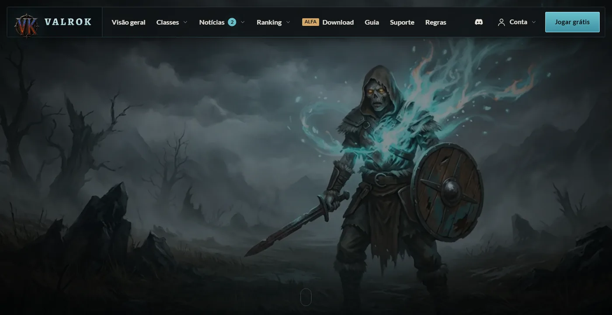

### Os pilares de Valrok

<table>
  <tr>
    <td width="33%" valign="top">
       
      <h3>I · Combate de ação</h3>
      Combos fluidos de espada, esquivas táticas e reações físicas reais a cada impacto. Posicionamento e tempo decidem o confronto — nada de combate travado.
    </td>
    <td width="33%" valign="top">
      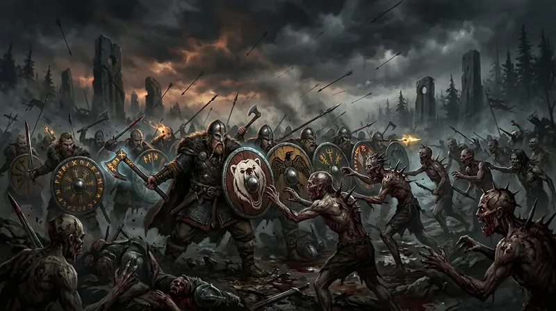 
      <h3>II · Economia e guildas</h3>
      Um mundo de cooperação e disputa territorial. Comércio direto entre jogadores e a construção de um império ao lado da sua guilda.
    </td>
    <td width="33%" valign="top">
       
      <h3>III · Progressão profunda</h3>
      Atributos, habilidades ativas e builds que recompensam estratégia. O grind volta a ter significado.
    </td>
  </tr>
</table>

## 🛡️ As classes

**4 classes, 8 especializações e 48 habilidades.** Cada classe tem duas formas de lutar.
Os nomes seguem os arquivos do jogo, e os ícones são sempre a versão **master** de cada skill.

<table>
  <tr>
    <td align="center" width="25%" valign="top">
       
      <h3>Warrior</h3>
      <i>Aço, escudo e fúria na linha de frente.</i>
    </td>
    <td align="center" width="25%" valign="top">
      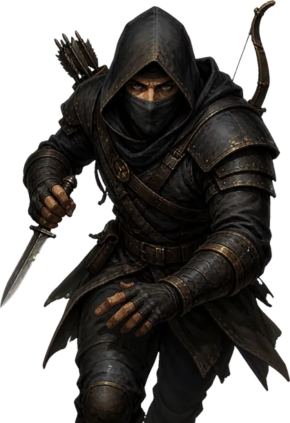 
      <h3>Mercenary</h3>
      <i>Flechas certeiras e lâminas nas sombras.</i>
    </td>
    <td align="center" width="25%" valign="top">
       
      <h3>Druid</h3>
      <i>A fúria da tempestade e a força da natureza.</i>
    </td>
    <td align="center" width="25%" valign="top">
       
      <h3>Mage</h3>
      <i>Fogo, gelo e runas arcanas.</i>
    </td>
  </tr>
</table>

### Warrior

Mestre do combate corpo a corpo, o Warrior avança onde os outros recuam. Machados pesados, escudos e golpes giratórios fazem dele o pilar de qualquer grupo — seja abrindo caminho com fúria ou segurando a linha com aço.

**Estilo:** Corpo a corpo · Linha de frente · Resistência

| | Especialização | |
|:-:|:--|:--|
| 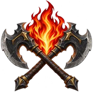 | **Berserker** | Fúria e machados. Dano bruto, golpes sangrentos e ataques que ficam mais perigosos quanto maior o risco. |
|  | **Vanguard** | Escudo e aço. Proteção, investidas e controle do campo de batalha para defender os aliados. |

  
  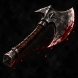
  
  
  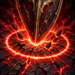
  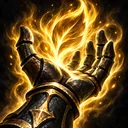
  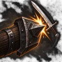
  
  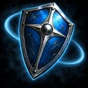
  
  
  

Cleaving Strike · Bloody Throw · Rising Blade · Predator's Fury · Seismic Impact · Battle Renewal · Disarming Charge · Shield Charge · Shield Throw · Shield Wall · Steel Vortex · Whirling Slash

 

### Mercenary

Ágil e letal, o Mercenary escolhe quando e onde lutar. Domina o arco com flechas de fogo, veneno e correntes, ou se esconde nas sombras para desferir punhaladas precisas antes que o inimigo perceba.

**Estilo:** Distância · Agilidade · Golpes críticos

| | Especialização | |
|:-:|:--|:--|
|  | **Archer** | Arco e flechas especiais. Dano à distância, fogo, veneno e chuva de flechas para controlar o combate. |
| 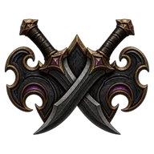 | **Rogue** | Lâminas e sombras. Furtividade, mobilidade e golpes críticos a curta distância. |

  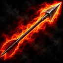
  
  
  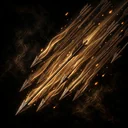
  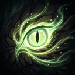
  
  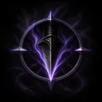
  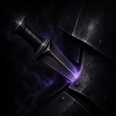
  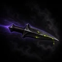
  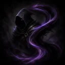
  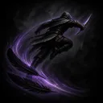
  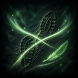

Fire Arrow · Pestilent Arrow · Shackling Arrow · Arrow Rain · Eagle Eye · Piercing Mastery · Lethal Focus · Shadow Stab · Hemlock Blade · Shadow Veil · Raven's Step · Wild Stride

 

### Druid

Guardião dos bosques antigos, o Druid canaliza o vento, o raio e a própria terra. Pode invocar tempestades sobre os inimigos ou fazer a vida brotar para proteger e curar seus aliados.

**Estilo:** Natureza · Controle · Suporte

| | Especialização | |
|:-:|:--|:--|
| 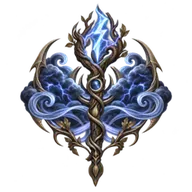 | **Stormcaller** | Vento, raio e terra. Controle de área e dano elemental que devasta grupos de inimigos. |
| 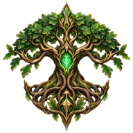 | **Verdant** | Vida e raízes. Cura, proteção e venenos da natureza que sustentam o grupo. |

  
  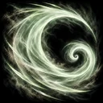
  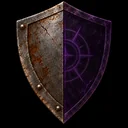
  
  
  
  
  
  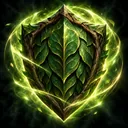
  
  
  

Thunderstorm · Gale Strike · Wither · Dust Veil · Grove's Blessing · Tree of Life · Renewing Touch · Lifeblood Sap · Nature's Aegis · Venomous Roots · Venomous Vine · Cursed Spores

 

### Mage

Estudioso das runas antigas, o Mage dobra o fogo e o gelo à sua vontade e grava selos arcanos no próprio campo de batalha. Pode devastar grupos com meteoros e lanças glaciais ou aprisionar e confundir inimigos com inscrições rúnicas.

**Estilo:** Distância · Magia elemental · Controle

| | Especialização | |
|:-:|:--|:--|
| 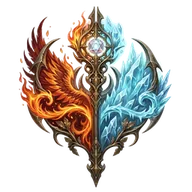 | **Elemental** | Fogo e gelo. Dano explosivo à distância, áreas de efeito e o equilíbrio entre chamas e geada. |
| 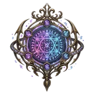 | **Runebinder** | Runas e selos arcanos. Controle do campo, armadilhas rúnicas e mobilidade para manter a distância. |

  
  
  
  
  
  
  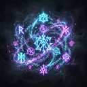
  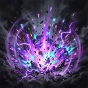
  
  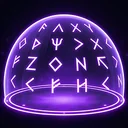
  
  

Fireball · Meteor · Glacial Lance · Glacial Prison · Frostfire Aura · Elemental Focus · Arcane Inscription · Runic Detonation · Domain of Seals · Arcane Collapse · Temporal Arcane · Blink

 

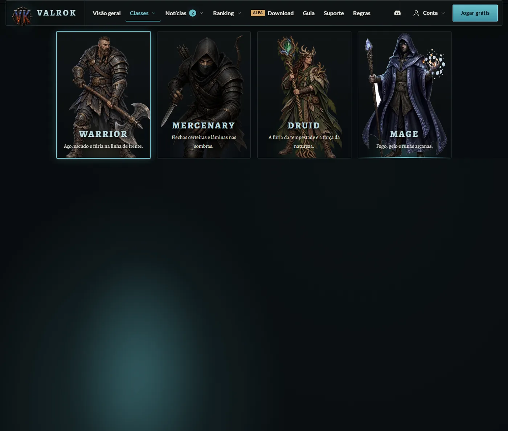

## 🗺️ O site, página por página

O menu segue o padrão dos sites da Blizzard: uma barra flutuante com a marca à esquerda, menus com título e subtítulo,
selos de destaque e a área da conta com o botão **Jogar grátis** à direita.

| Menu | O que tem lá |
|:--|:--|
| **Visão geral** | O que é Valrok, combate, progressão, economia e guildas, e a tecnologia por trás do jogo. |
| **Classes** ▾ | Warrior, Mercenary, Druid e Mage — retrato, estilo de jogo, especializações e todas as habilidades. |
| **Notícias** `NOVO` | Anúncios, diários de desenvolvimento e novidades sobre os testes, com filtro por categoria. |
| **Ranking** ▾ | Top jogadores e top guildas, com busca por nome. O ranking oficial começa com o Alfa. |
| **Download** `ALFA` | Plataformas, como entrar no Alfa fechado e requisitos de sistema. |
| **···** | Guia do iniciante, Suporte & FAQ, Regras e Discord. |
| **Conta** ▾ | Entrar e Criar conta — ou, já conectado, Minha conta e Sair. |

**Início** reúne tudo: o hero com a arte do jogo, o status do servidor, as últimas notícias, os pilares, as classes,
o ranking, a jornada do projeto e o convite para criar conta.

<table>
  <tr>
    <td width="50%">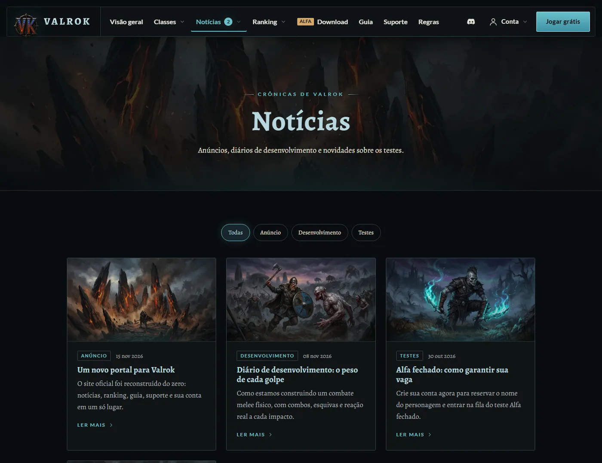</td>
    <td width="50%"></td>
  </tr>
  <tr>
    <td align="center">Notícias</td>
    <td align="center">Ranking</td>
  </tr>
</table>

### 📜 Notícias publicadas

<table>
  <tr>
    <td width="25%" valign="top">
       
      <code>ANÚNCIO</code> · 15 nov 2026 
      <b>Um novo portal para Valrok</b> 
      O site oficial foi reconstruído do zero: notícias, ranking, guia, suporte e sua conta em um só lugar.
    </td>
    <td width="25%" valign="top">
       
      <code>DESENVOLVIMENTO</code> · 8 nov 2026 
      <b>Diário de desenvolvimento: o peso de cada golpe</b> 
      Como estamos construindo um combate melee físico, com combos, esquivas e reação real a cada impacto.
    </td>
    <td width="25%" valign="top">
       
      <code>TESTES</code> · 30 out 2026 
      <b>Alfa fechado: como garantir sua vaga</b> 
      Crie sua conta agora para reservar o nome do personagem e entrar na fila do teste Alfa fechado.
    </td>
    <td width="25%" valign="top">
       
      <code>DESENVOLVIMENTO</code> · 18 out 2026 
      <b>Economia de jogadores e guildas fortes</b> 
      Um mundo baseado em cooperação e disputa territorial, com trocas diretas entre jogadores.
    </td>
  </tr>
</table>

### 👤 Conta do jogador

- **Criar conta** — grátis; reserva o nome do personagem e coloca o jogador na fila de convites do Alfa fechado.
- **Entrar** — acesso com usuário e senha.
- **Minha conta** — dados da conta, personagens criados e o status do convite do Alfa.

A sessão é protegida pelo servidor do jogo: o site nunca guarda senha, token ou dados sensíveis no navegador.
Enquanto a integração com o servidor é concluída, essas telas funcionam com dados de demonstração.

## 🧊 Identidade visual

A identidade do site nasce da **tela de habilidades do jogo** e do **ValrokLauncher**: a paleta **Azul Gelo Rúnico**,
com detalhes em bronze e ouro para manter o clima de fantasia sombria medieval.

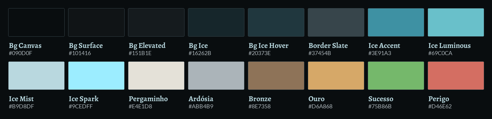

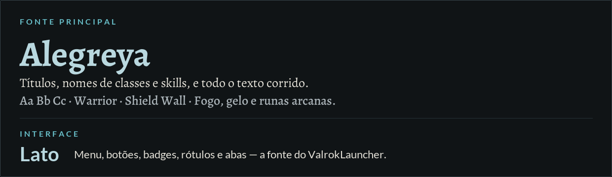

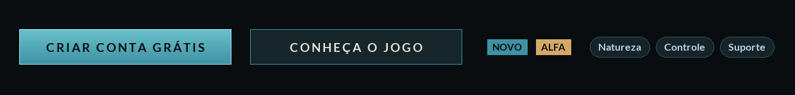

- **Botão principal** — gradiente de gelo luminoso com texto escuro, para ações como *Criar conta grátis* e *Jogar grátis*.
- **Botão rúnico** — fundo de gelo escuro com borda azul, fiel aos botões da tela de habilidades.
- **Cards** — superfície escura com borda ardósia; ao passar o mouse, ganham tinta de gelo e um brilho rúnico.
- **Molduras e ornamentos** — cantos e divisores em bronze, com o losango rúnico como assinatura.
- **Efeitos** — partículas rúnicas azul-gelo com algumas faíscas douradas, e arte do jogo em movimento lento no topo das páginas.

### A marca

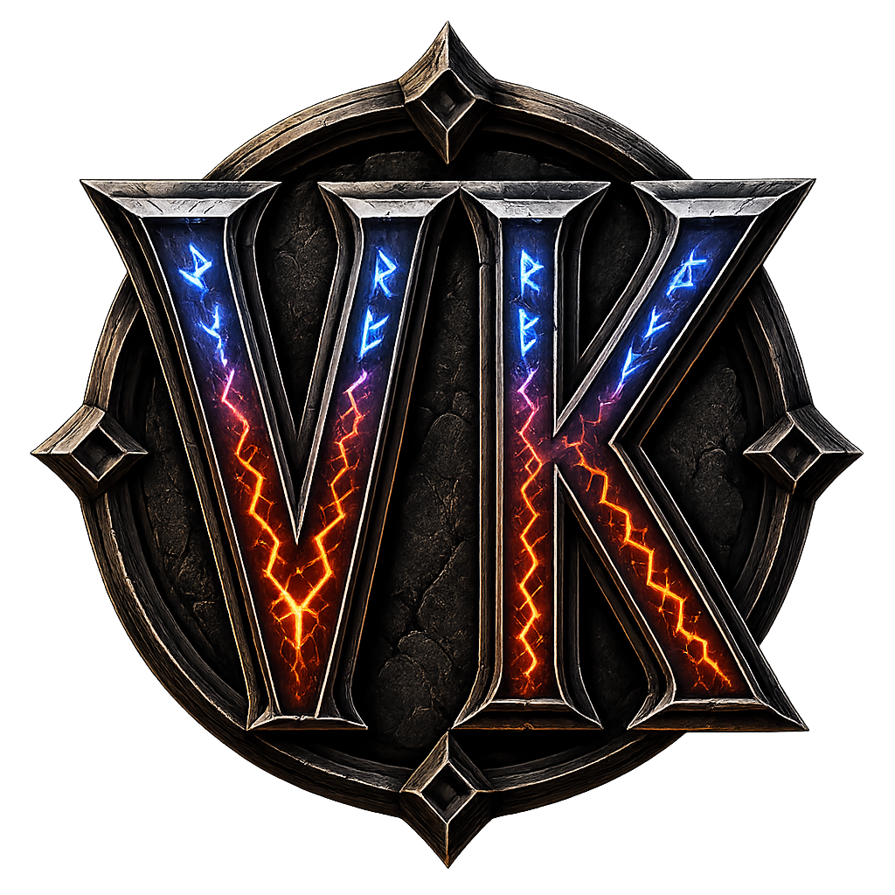

O emblema <b>VK</b> em ferro forjado, com runas azuis e veios de brasa.

### Arte do jogo

  
  
  
  
  

Telas de carregamento do jogo, usadas no topo das páginas, nas notícias e nos destaques.

## 🔥 Fase do projeto

| | Fase | |
|:-:|:--|:--|
| ◆ | **Protótipo** | Combate, movimentação e servidor persistente. |
| 🔷 | **Pré-Alfa** — *agora* | Habilidades, inventário, economia e telemetria. |
| ◇ | Alfa fechado | Primeiros jogadores convidados por ondas. |
| ◇ | Beta aberto | Guildas, territórios e balanceamento. |
| ◇ | Lançamento | O mundo de Valrok aberto a todos. |

**Crie sua conta em [valrok.com.br](https://valrok.com.br), reserve o nome do seu personagem e entre na fila do Alfa fechado.**

   
  <b>VALROK</b> 
  © 2026 Valrok · Produção brasileira e independente · Em desenvolvimento ativo — conteúdo sujeito a mudanças 
  Documentação técnica (instalação, testes e publicação): <a href="docs/DESENVOLVIMENTO.md">docs/DESENVOLVIMENTO.md</a>

