

  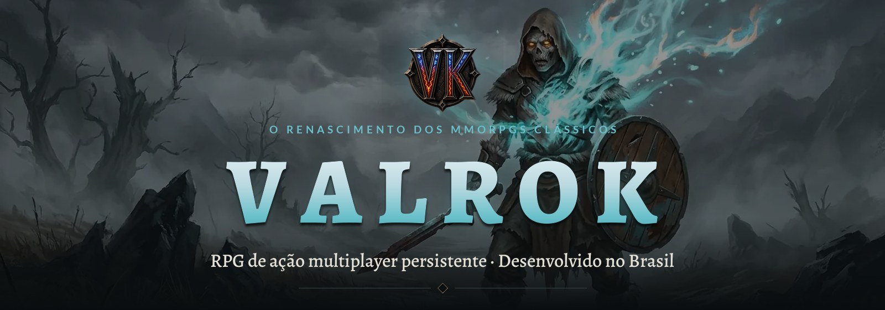

  <b>Site oficial do Valrok</b> — notícias, classes, ranking, guia e a sua conta em um só lugar. 
  Produção 100% brasileira e independente · Godot Engine · Pré-Alfa

  <a href="https://valrok.com.br"><b>valrok.com.br</b></a> &nbsp;·&nbsp;
  <a href="#classes">Classes</a> &nbsp;·&nbsp;
  <a href="#paginas">Páginas</a> &nbsp;·&nbsp;
  <a href="#fase-do-projeto">Fase do projeto</a>

## ⚔️ O jogo

**Valrok** é um RPG de ação multiplayer persistente em desenvolvimento ativo. Ele resgata a essência desafiadora e a
progressão profunda dos RPGs que marcaram os anos 2000, unindo **combate melee físico** a um **mundo em constante evolução**.

### Os pilares de Valrok

<table>
  <tr>
    <td width="33%" valign="top">
      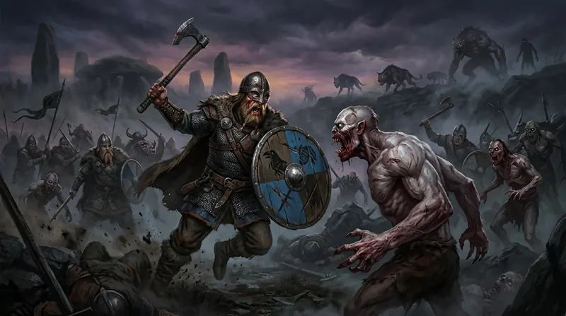 
      <h3>I · Combate de ação</h3>
      Combos fluidos de espada, esquivas táticas e reações físicas reais a cada impacto. Posicionamento e tempo decidem o confronto — nada de combate travado.
    </td>
    <td width="33%" valign="top">
       
      <h3>II · Economia e guildas</h3>
      Um mundo de cooperação e disputa territorial. Comércio direto entre jogadores e a construção de um império ao lado da sua guilda.
    </td>
    <td width="33%" valign="top">
      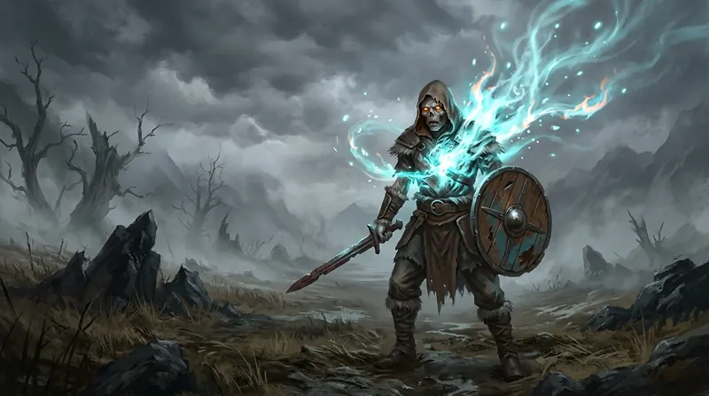 
      <h3>III · Progressão profunda</h3>
      Atributos, habilidades ativas e builds que recompensam estratégia. O grind volta a ter significado.
    </td>
  </tr>
</table>

### Arte do jogo

  
  
  
  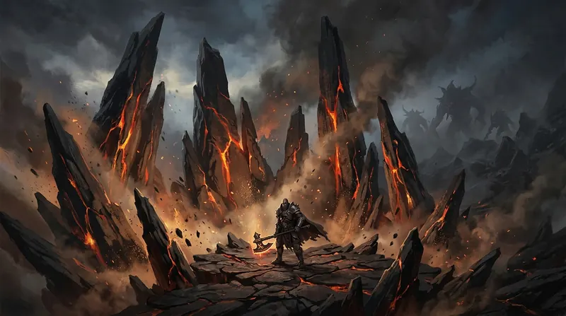
  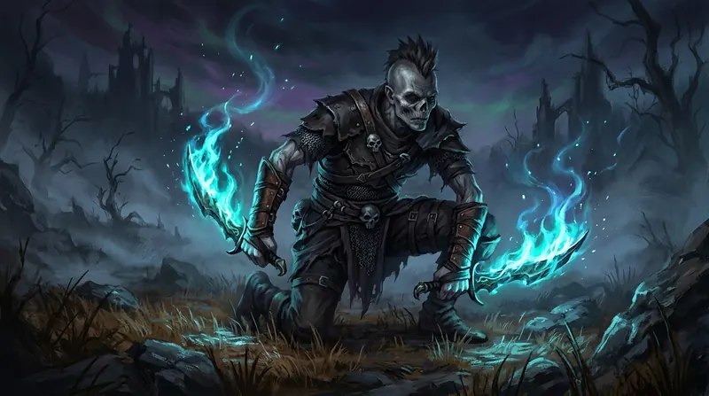

Telas de carregamento do jogo.

## 🛡️ As classes

**4 classes, 8 especializações e 48 habilidades.** Cada classe tem duas formas de lutar — abra uma especialização para ver as habilidades dela.

<table>
  <tr>
    <td align="center" width="25%" valign="top">
      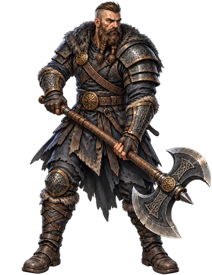 
      <h3>Warrior</h3>
      <i>Aço, escudo e fúria na linha de frente.</i>
    </td>
    <td align="center" width="25%" valign="top">
       
      <h3>Mercenary</h3>
      <i>Flechas certeiras e lâminas nas sombras.</i>
    </td>
    <td align="center" width="25%" valign="top">
      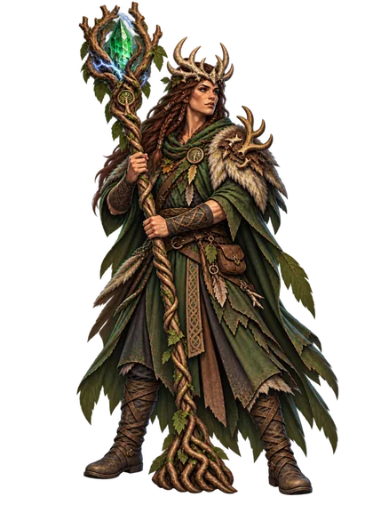 
      <h3>Druid</h3>
      <i>A fúria da tempestade e a força da natureza.</i>
    </td>
    <td align="center" width="25%" valign="top">
      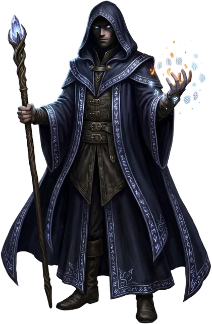 
      <h3>Mage</h3>
      <i>Fogo, gelo e runas arcanas.</i>
    </td>
  </tr>
</table>

### Warrior

Mestre do combate corpo a corpo, o Warrior avança onde os outros recuam. Machados pesados, escudos e golpes giratórios fazem dele o pilar de qualquer grupo — seja abrindo caminho com fúria ou segurando a linha com aço.

**Estilo:** Corpo a corpo · Linha de frente · Resistência

 <b>Berserker</b> — Fúria e machados. Dano bruto, golpes sangrentos e ataques que ficam mais perigosos quanto maior o risco. <i>(6 habilidades)</i>

<table>
<tr><th></th><th>Habilidade</th><th>Descrição</th></tr>
<tr><td>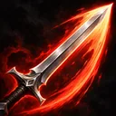</td><td><b>Rising Blade</b></td><td>Corte ascendente que lança a lâmina para cima e desequilibra o alvo.</td></tr>
<tr><td>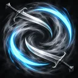</td><td><b>Steel Vortex</b></td><td>Gira em um vórtice de aço que atrai e fere os inimigos ao redor.</td></tr>
<tr><td></td><td><b>Disarming Charge</b></td><td>Investida que atinge o alvo e reduz temporariamente o dano dos ataques dele.</td></tr>
<tr><td>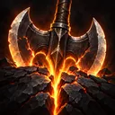</td><td><b>Cleaving Strike</b></td><td>Golpe pesado de machado que fende tudo à frente, atingindo vários inimigos próximos.</td></tr>
<tr><td></td><td><b>Bloody Throw</b></td><td>Arremessa o machado em um inimigo distante, causando dano e sangramento.</td></tr>
<tr><td>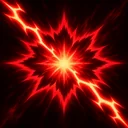</td><td><b>Predator's Fury</b></td><td>Explosão de fúria rubra que aumenta o dano e a velocidade de ataque por alguns segundos.</td></tr>
</table>

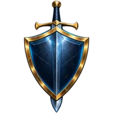 <b>Vanguard</b> — Escudo e aço. Proteção, investidas e controle do campo de batalha para defender os aliados. <i>(6 habilidades)</i>

<table>
<tr><th></th><th>Habilidade</th><th>Descrição</th></tr>
<tr><td>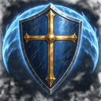</td><td><b>Shield Wall</b></td><td>Ergue o escudo como uma muralha, reduzindo muito o dano recebido de frente.</td></tr>
<tr><td></td><td><b>Seismic Impact</b></td><td>Golpeia o chão com força e libera uma onda de choque que atinge todos ao redor.</td></tr>
<tr><td>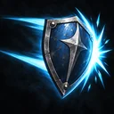</td><td><b>Shield Charge</b></td><td>Avança com o escudo erguido e derruba o primeiro inimigo no caminho.</td></tr>
<tr><td>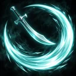</td><td><b>Whirling Slash</b></td><td>Corte giratório que atinge todos os inimigos em volta.</td></tr>
<tr><td></td><td><b>Shield Throw</b></td><td>Arremessa o escudo, que atinge o alvo e ricocheteia em inimigos próximos.</td></tr>
<tr><td></td><td><b>Battle Renewal</b></td><td>Canaliza a energia do combate para recuperar vida a cada golpe acertado.</td></tr>
</table>

 

### Mercenary

Ágil e letal, o Mercenary escolhe quando e onde lutar. Domina o arco com flechas de fogo, veneno e correntes, ou se esconde nas sombras para desferir punhaladas precisas antes que o inimigo perceba.

**Estilo:** Distância · Agilidade · Golpes críticos

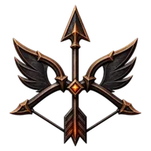 <b>Archer</b> — Arco e flechas especiais. Dano à distância, fogo, veneno e chuva de flechas para controlar o combate. <i>(6 habilidades)</i>

<table>
<tr><th></th><th>Habilidade</th><th>Descrição</th></tr>
<tr><td></td><td><b>Eagle Eye</b></td><td>Concentra a mira, aumentando o alcance e a chance de acerto crítico por um tempo.</td></tr>
<tr><td></td><td><b>Fire Arrow</b></td><td>Flecha incendiária que causa dano e deixa o alvo em chamas.</td></tr>
<tr><td>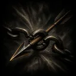</td><td><b>Shackling Arrow</b></td><td>Flecha com correntes que prende o alvo no lugar por alguns instantes.</td></tr>
<tr><td></td><td><b>Arrow Rain</b></td><td>Dispara uma chuva de flechas sobre uma área, atingindo todos os inimigos nela.</td></tr>
<tr><td>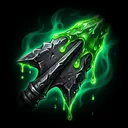</td><td><b>Pestilent Arrow</b></td><td>Flecha envenenada que espalha uma praga e causa dano contínuo.</td></tr>
<tr><td></td><td><b>Wild Stride</b></td><td>Passos ligeiros pelo ermo que aumentam a velocidade de movimento para perseguir ou escapar.</td></tr>
</table>

 <b>Rogue</b> — Lâminas e sombras. Furtividade, mobilidade e golpes críticos a curta distância. <i>(6 habilidades)</i>

<table>
<tr><th></th><th>Habilidade</th><th>Descrição</th></tr>
<tr><td></td><td><b>Lethal Focus</b></td><td>Foco absoluto que aumenta o dano crítico do próximo ataque.</td></tr>
<tr><td></td><td><b>Shadow Veil</b></td><td>Envolve-se em sombras e fica mais difícil de ser visto e atingido por alguns segundos.</td></tr>
<tr><td></td><td><b>Shadow Stab</b></td><td>Punhalada rápida vinda das sombras, com dano extra ao atingir o alvo pelas costas.</td></tr>
<tr><td></td><td><b>Raven's Step</b></td><td>Passo veloz como o de um corvo, avançando uma curta distância em um instante.</td></tr>
<tr><td></td><td><b>Hemlock Blade</b></td><td>Envenena as lâminas com cicuta, fazendo os ataques causarem dano contínuo.</td></tr>
<tr><td>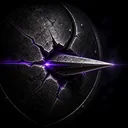</td><td><b>Piercing Mastery</b></td><td>Maestria em golpes perfurantes: os ataques do ladino atravessam parte da armadura do alvo.</td></tr>
</table>

 

### Druid

Guardião dos bosques antigos, o Druid canaliza o vento, o raio e a própria terra. Pode invocar tempestades sobre os inimigos ou fazer a vida brotar para proteger e curar seus aliados.

**Estilo:** Natureza · Controle · Suporte

 <b>Stormcaller</b> — Vento, raio, terra e decadência. Controle de área, dano elemental e maldições que enfraquecem grupos de inimigos. <i>(6 habilidades)</i>

<table>
<tr><th></th><th>Habilidade</th><th>Descrição</th></tr>
<tr><td></td><td><b>Cursed Spores</b></td><td>Cogumelos amaldiçoados liberam esporos que envenenam quem estiver por perto.</td></tr>
<tr><td></td><td><b>Thunderstorm</b></td><td>Invoca uma tempestade que lança raios sobre os inimigos na área.</td></tr>
<tr><td></td><td><b>Gale Strike</b></td><td>Golpe de vento cortante, a habilidade básica de vento do druida.</td></tr>
<tr><td></td><td><b>Venomous Vine</b></td><td>Vinhas espinhosas e venenosas que ferem e enfraquecem os inimigos ao alcance.</td></tr>
<tr><td></td><td><b>Dust Veil</b></td><td>Levanta um véu de poeira que atrapalha a visão e a mira dos inimigos.</td></tr>
<tr><td></td><td><b>Wither</b></td><td>Magia de decadência que corrói as defesas do alvo e o deixa mais vulnerável.</td></tr>
</table>

 <b>Verdant</b> — Vida e vinhas. Cura, proteção e plantas venenosas que sustentam o grupo e punem quem se aproxima. <i>(6 habilidades)</i>

<table>
<tr><th></th><th>Habilidade</th><th>Descrição</th></tr>
<tr><td></td><td><b>Grove's Blessing</b></td><td>Bênção do bosque antigo que fortalece os aliados próximos.</td></tr>
<tr><td></td><td><b>Tree of Life</b></td><td>Faz brotar uma árvore da vida que cura continuamente os aliados ao redor.</td></tr>
<tr><td></td><td><b>Renewing Touch</b></td><td>Toque de cura que restaura vida e purifica efeitos negativos do aliado.</td></tr>
<tr><td></td><td><b>Venomous Roots</b></td><td>Raízes espinhosas e venenosas brotam do chão, prendendo e envenenando os inimigos.</td></tr>
<tr><td></td><td><b>Lifeblood Sap</b></td><td>Seiva vital que cura um aliado ao longo do tempo.</td></tr>
<tr><td></td><td><b>Nature's Aegis</b></td><td>Escudo de casca e folhas que absorve dano por alguns segundos.</td></tr>
</table>

 

### Mage

Estudioso das runas antigas, o Mage dobra o fogo e o gelo à sua vontade e grava selos arcanos no próprio campo de batalha. Pode devastar grupos com meteoros e lanças glaciais ou aprisionar e confundir inimigos com inscrições rúnicas.

**Estilo:** Distância · Magia elemental · Controle

 <b>Elemental</b> — Fogo e gelo. Dano explosivo à distância, áreas de efeito e o equilíbrio entre chamas e geada. <i>(6 habilidades)</i>

<table>
<tr><th></th><th>Habilidade</th><th>Descrição</th></tr>
<tr><td></td><td><b>Elemental Focus</b></td><td>Concentra o poder elemental e aumenta o dano dos próximos feitiços de fogo e gelo.</td></tr>
<tr><td>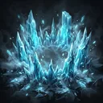</td><td><b>Glacial Prison</b></td><td>Aprisiona o inimigo em gelo, deixando-o imóvel por alguns instantes.</td></tr>
<tr><td></td><td><b>Fireball</b></td><td>Lança uma bola de fogo que explode ao atingir o alvo.</td></tr>
<tr><td>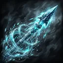</td><td><b>Glacial Lance</b></td><td>Dispara uma lança de gelo que perfura e desacelera o alvo.</td></tr>
<tr><td></td><td><b>Meteor</b></td><td>Invoca um meteoro que cai sobre uma área e causa dano devastador.</td></tr>
<tr><td></td><td><b>Frostfire Aura</b></td><td>Aura de fogo e gelo que fere e desacelera quem se aproxima do mago.</td></tr>
</table>

 <b>Runebinder</b> — Runas e selos arcanos. Controle do campo, armadilhas rúnicas e mobilidade para manter a distância. <i>(6 habilidades)</i>

<table>
<tr><th></th><th>Habilidade</th><th>Descrição</th></tr>
<tr><td></td><td><b>Arcane Inscription</b></td><td>Inscreve runas arcanas que potencializam os próximos feitiços rúnicos.</td></tr>
<tr><td></td><td><b>Runic Detonation</b></td><td>Detona as runas ativas em uma explosão arcana em área.</td></tr>
<tr><td></td><td><b>Domain of Seals</b></td><td>Cria um domínio de selos arcanos que restringe os inimigos dentro da área.</td></tr>
<tr><td></td><td><b>Arcane Collapse</b></td><td>Abre um vórtice arcano que puxa os inimigos para o centro.</td></tr>
<tr><td>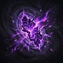</td><td><b>Blink</b></td><td>Teletransporta o mago por uma curta distância na direção desejada.</td></tr>
<tr><td></td><td><b>Temporal Arcane</b></td><td>Distorce o tempo, acelerando o mago e reduzindo a recarga das habilidades.</td></tr>
</table>

 

## 🗺️ O site, página por página

| Menu | O que tem lá |
|:--|:--|
| **Visão geral** | O que é Valrok, combate, progressão, economia e guildas, e a tecnologia por trás do jogo. |
| **Classes** ▾ | Warrior, Mercenary, Druid e Mage — retrato, estilo de jogo, especializações e todas as habilidades. |
| **Notícias** ▾ | As notícias da semana, com contador das que você ainda não leu, e o arquivo completo com filtro por categoria. |
| **Ranking** ▾ | Top jogadores e top guildas, com busca por nome. O ranking oficial começa com o Alfa. |
| **Download** `ALFA` | Plataformas, como entrar no Alfa fechado e requisitos de sistema. |
| **Guia** | Primeiros passos: conta, combate, progressão e economia. |
| **Suporte** | Perguntas frequentes e canais de contato. |
| **Regras** | Código de conduta do jogo. |
| **Discord** | Comunidade e anúncios. |
| **Conta** ▾ | Entrar e Criar conta — ou, já conectado, Minha conta e Sair. |

**Início** reúne tudo: o hero com a arte do jogo, o status do servidor, as últimas notícias, os pilares, as classes,
o ranking, a jornada do projeto e o convite para criar conta.

<table>
  <tr>
    <td width="50%"></td>
    <td width="50%">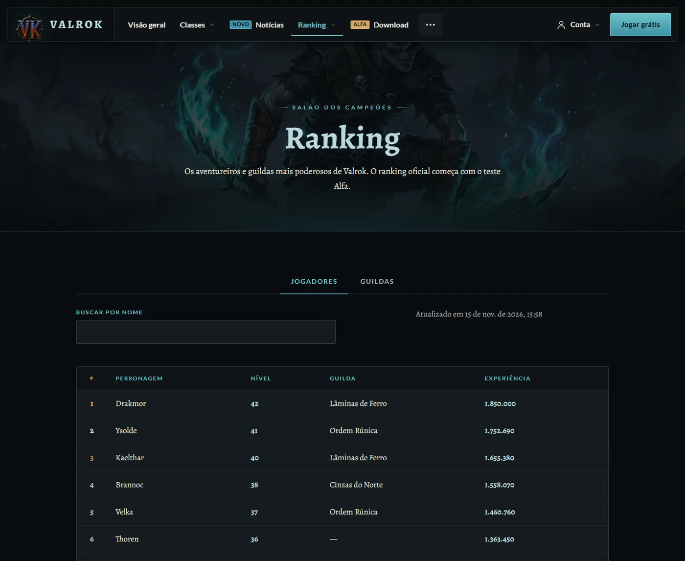</td>
  </tr>
  <tr>
    <td align="center">Notícias</td>
    <td align="center">Ranking</td>
  </tr>
</table>

### 📜 Notícias publicadas

<table>
  <tr>
    <td width="25%" valign="top">
       
      <code>ANÚNCIO</code> · 15 nov 2026 
      <b>Um novo portal para Valrok</b> 
      O site oficial foi reconstruído do zero: notícias, ranking, guia, suporte e sua conta em um só lugar.
    </td>
    <td width="25%" valign="top">
       
      <code>DESENVOLVIMENTO</code> · 8 nov 2026 
      <b>Diário de desenvolvimento: o peso de cada golpe</b> 
      Como estamos construindo um combate melee físico, com combos, esquivas e reação real a cada impacto.
    </td>
    <td width="25%" valign="top">
       
      <code>TESTES</code> · 30 out 2026 
      <b>Alfa fechado: como garantir sua vaga</b> 
      Crie sua conta agora para reservar o nome do personagem e entrar na fila do teste Alfa fechado.
    </td>
    <td width="25%" valign="top">
       
      <code>DESENVOLVIMENTO</code> · 18 out 2026 
      <b>Economia de jogadores e guildas fortes</b> 
      Um mundo baseado em cooperação e disputa territorial, com trocas diretas entre jogadores.
    </td>
  </tr>
</table>

### 👤 Conta do jogador

- **Criar conta** — grátis; reserva o nome do personagem e coloca o jogador na fila de convites do Alfa fechado.
- **Entrar** — acesso com usuário e senha.
- **Minha conta** — dados da conta, personagens criados e o status do convite do Alfa.

A sessão é protegida pelo servidor do jogo: o site nunca guarda senha, token ou dados sensíveis no navegador.
Enquanto a integração com o servidor é concluída, essas telas funcionam com dados de demonstração.

## 🔥 Fase do projeto

| | Fase | |
|:-:|:--|:--|
| ◆ | **Protótipo** | Combate, movimentação e servidor persistente. |
| 🔷 | **Pré-Alfa** — *agora* | Habilidades, inventário, economia e telemetria. |
| ◇ | Alfa fechado | Primeiros jogadores convidados por ondas. |
| ◇ | Beta aberto | Guildas, territórios e balanceamento. |
| ◇ | Lançamento | O mundo de Valrok aberto a todos. |

**Crie sua conta em [valrok.com.br](https://valrok.com.br), reserve o nome do seu personagem e entre na fila do Alfa fechado.**

   
  <b>VALROK</b> 
  © 2026 Valrok · Produção brasileira e independente · Em desenvolvimento ativo — conteúdo sujeito a mudanças 
  Documentação técnica (instalação, testes e publicação): <a href="docs/DESENVOLVIMENTO.md">docs/DESENVOLVIMENTO.md</a>

